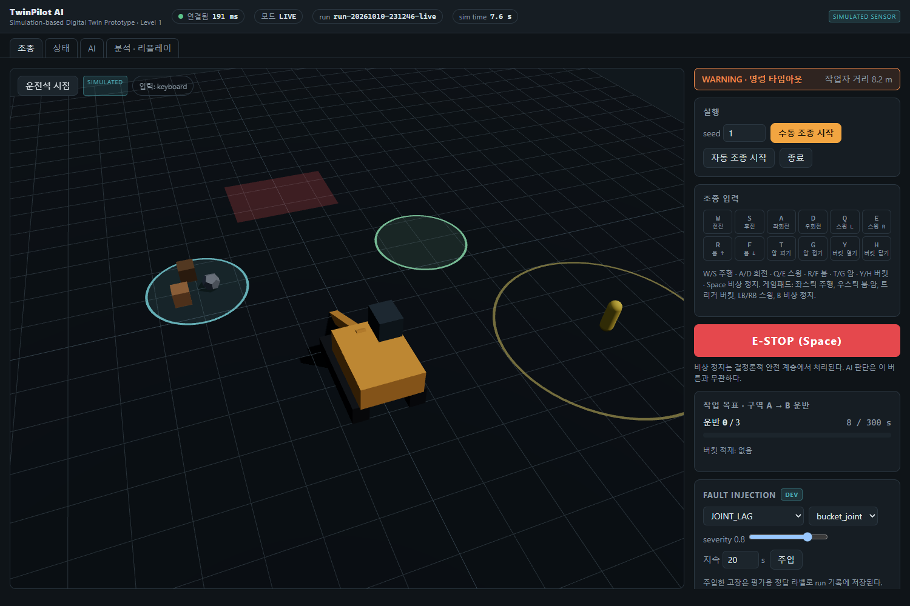
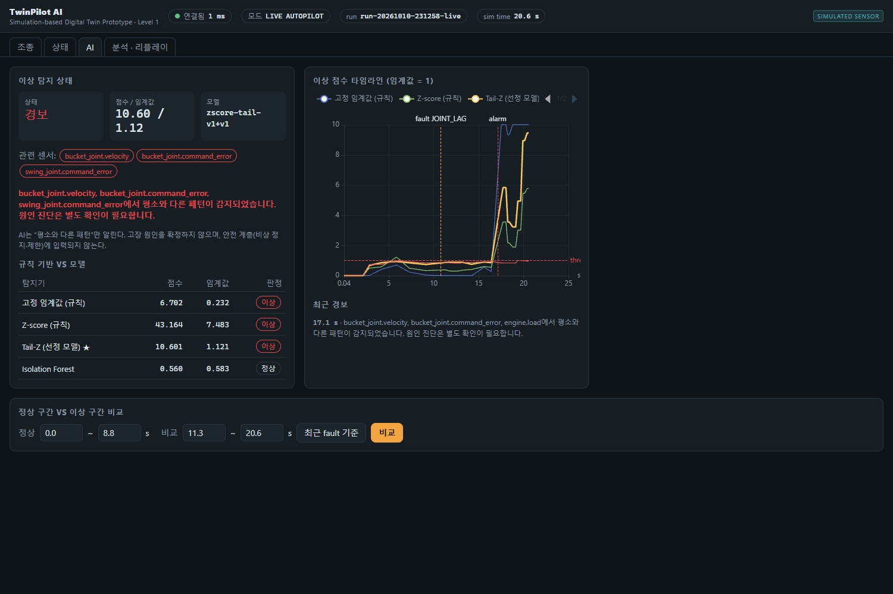
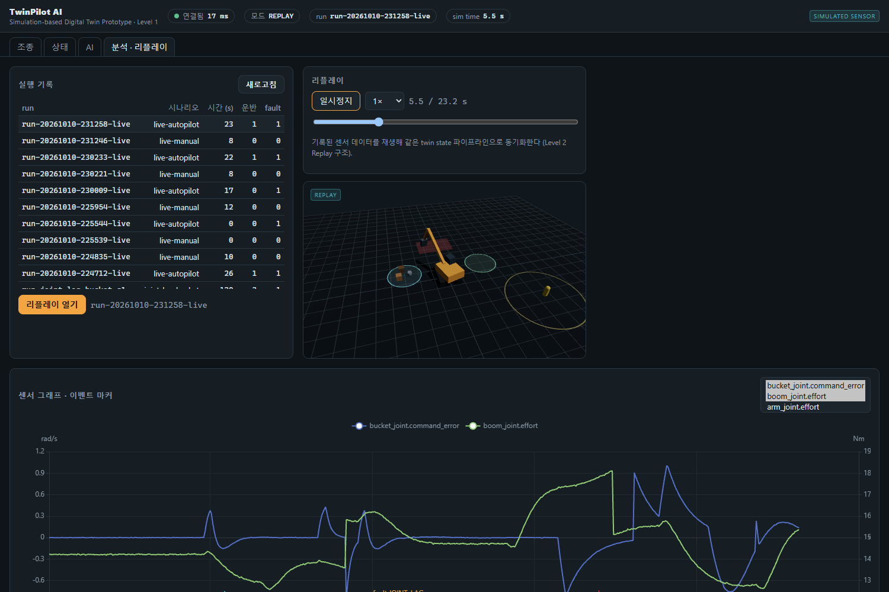

# TwinPilot AI

> **시뮬레이션 기반 디지털 트윈 프로토타입 — Level 1 (Simulation)**
> 실제 굴착기·실제 센서와 연결되어 있지 않다. 모든 센서값은 `SIMULATED SENSOR` 이다.

가상 굴착기를 조종하며 장비 상태와 작업 성과를 확인하고, 고장 주입(fault injection)으로 만든 센서 이상을
규칙 기준선과 이상 탐지 모델로 탐지·평가하는 프로젝트. 실제 센서 연동(Level 2 Replay / Level 3 Connected)을
고려한 데이터 구조로 설계했다.



## 무엇이 되나

- 키보드·게임패드로 굴착기 조종 (주행, 상부 회전, 붐·암·버킷) → 운반물 3개를 구역 A에서 B로 이동
- 결정론적 Control Safety Layer: 비상 정지, 명령 타임아웃, 변화율·관절 한계, 전복 위험, 작업자 최소 거리, 금지 구역
- 가상 센서 telemetry(단위·sim time·sequence 포함) → 시간 정렬된 Twin State Store → WebSocket 10 Hz
- Fault injection 5종(JOINT_LAG, FRICTION_INCREASE, SENSOR_NOISE, SENSOR_STUCK, TEMP_RISE), 정답 라벨 기록
- 이상 탐지: 고정 임계값 / Z-score / Tail-normalized Z-score / Isolation Forest 비교, 물리 잔차(디지털 트윈 잔차) 특징
- 정상·이상 구간 비교, 작업 성과 보고서(원시 지표 + 점수), 실행 기록 리플레이(3D·그래프 동기화)

| AI 화면 | 분석 · 리플레이 |
|---|---|
|  |  |

## 웹 데모 (설치 없이)

**https://jngbnss.github.io/twinpilot-ai/** — 서버 없이 브라우저에서 바로 실행되는 정적 데모(`pages/`).
시뮬레이터·Control Safety Layer·스크립트 조종기·`residual` 특징·탐지기 4종을 JavaScript로 옮겼고,
탐지기 파라미터(Isolation Forest 트리 포함)는 저장소 학습 코드로 학습해 JSON으로 내보낸 것을 그대로 쓴다.
자동/수동 조종, 고장 5종 주입, 실시간 센서·점수 그래프, 알림 로그, 실행 중 Precision/Recall 비교를 제공한다.

```bash
# 모델 재학습·내보내기 (정상 train/val + test 평가, 약 2분) → pages/model/detector-v1-residual.json
uv run python scripts/pages_demo/export_model.py --root .demo-data --workers 8
# Python 기준값 생성 후 JS 포트 검증 (특징·점수 상대오차 < 1e-9, 무노이즈 궤적·안전 규칙 일치)
uv run python scripts/pages_demo/make_fixture.py --model .demo-data/detector-v1-residual.joblib --out .demo-data/fixture.json
node scripts/pages_demo/check_demo.mjs .demo-data/fixture.json
```

센서 노이즈 난수 생성기만 Python(PCG64)과 다르다. 모델은 자동 조종 정상 데이터로만 학습했으므로
수동 조종에서는 오경보가 크게 늘어난다(아래 "미확인 조건" 결과와 같은 현상).

## 빠른 시작

요구: [uv](https://docs.astral.sh/uv/), Node 24.

```bash
uv sync --all-packages
cd frontend && npm install && cd ..

# 이상 탐지 데이터셋·모델 (최초 1회, 약 4분)
uv run python -m twinpilot_ai.training.make_dataset --version v1 --workers 10
uv run python -m twinpilot_ai.evaluation.evaluate
```

실행 (Windows):

```powershell
powershell -ExecutionPolicy Bypass -File scripts\start-dev.ps1
```

또는 터미널 두 개에서:

```bash
uv run python -m uvicorn app.main:app --app-dir backend --port 8770   # API: http://127.0.0.1:8770/docs
cd frontend && npx vite                                                # 대시보드: http://127.0.0.1:5290
```

> 같은 PC의 다른 프로젝트와 겹치지 않도록 포트는 8770 / 5290을 쓴다 (D-017).
> Windows 애플리케이션 제어 정책이 uv가 만든 `.exe` 진입점을 막을 수 있어 `python -m` 형식을 쓴다 (D-014).

## 데모 순서

1. **조종** 탭 → `수동 조종 시작` → W/S·A/D 주행, Q/E 스윙, R/F 붐, T/G 암, Y/H 버킷. 버킷을 운반물 위에서 닫으면 집고, 구역 B에서 열면 내려놓는다. (`자동 조종 시작`은 스크립트 조종기가 작업을 수행한다.)
2. 오른쪽 **Fault Injection** 패널에서 `JOINT_LAG · bucket_joint · 0.8` 주입 → **AI** 탭에서 점수가 임계값(1.0)을 넘고 관련 센서가 표시된다.
3. AI 탭 아래 **정상 구간 vs 이상 구간 비교** → `최근 fault 기준` → `비교`.
4. 조종 탭에서 `종료` → **분석 · 리플레이** 탭에서 run 선택 → 성과 보고서 확인(JSON/Markdown 다운로드) → `리플레이 열기` → `재생`.

## 테스트

```bash
uv run ruff check . && uv run pytest                     # Python 93 tests
cd frontend && npm run typecheck && npm test && npm run build
uv run python -m twinpilot_sim run --seed 1 --duration 120 --fault simulation/fault-scenarios/joint_lag_bucket.yaml
uv run python scripts/ws_smoke.py                          # 백엔드 실행 중일 때
uv run python scripts/anomaly_smoke.py
node frontend/e2e/ui-smoke.mjs                             # 백엔드+대시보드 실행 중, 시스템 Edge 사용
```

## 이상 탐지 결과 (dataset v1, test split)

| 모델 | F1 | run 탐지율 | 탐지 지연 중앙값 |
|------|----|-----------|----------------|
| Z-score (full 특징) | 0.723 | 0.78 | 1.2 s |
| Isolation Forest (full 특징) | 0.000 | 0.00 | – |
| **Tail-normalized Z-score + 물리 잔차 특징 (운영)** | **0.828** | **0.91** | **0.8 s** |

미확인 조건(빠른 조종 1.4×)에서는 오경보가 크게 늘어난다. 실패 원인과 다음 실험은
[`docs/experiments.md`](docs/experiments.md), 전체 표는 [`docs/eval/eval-v1.md`](docs/eval/eval-v1.md).

## 구조

| 경로 | 내용 |
|------|------|
| `sim/` | 결정론 Python 굴착기 시뮬레이터, telemetry 스키마, Control Safety Layer, fault injection, CLI |
| `backend/` | FastAPI, Twin State Store, Live/Replay TelemetrySource, WebSocket, 작업 리포트, 실시간 이상 탐지 |
| `ai/` | 데이터셋 생성, 특징량, 탐지기, 평가 |
| `frontend/` | React + TypeScript + Three.js + ECharts 대시보드 |
| `simulation/` | fault 시나리오 |
| `datasets/manifests/` | 데이터셋 매니페스트 (데이터 자체는 Git 제외, 명령으로 재생성) |
| `evals/` | CI 고정 이상 탐지 케이스 |
| `docs/` | 설계·결정·실험 기록 — [구현 계획](docs/implementation-plan.md), [아키텍처](docs/architecture.md), [결정 로그](docs/decision-log.md) |

Gazebo / ROS 2 Jazzy 연동은 같은 `SimulatorAdapter` 인터페이스의 두 번째 구현으로 계획되어 있다
([`docs/prompts/phase-5-gazebo-adapter.md`](docs/prompts/phase-5-gazebo-adapter.md)).

## 범위 밖

실제 중장비 원격 제어, 안전 인증, 정밀 토사·유압 해석, 실제 고장 원인 진단.
자세한 한계는 [`docs/safety-limitations.md`](docs/safety-limitations.md).

## 라이선스

MIT. 사용 OSS 라이선스는 [`docs/licenses.md`](docs/licenses.md).
